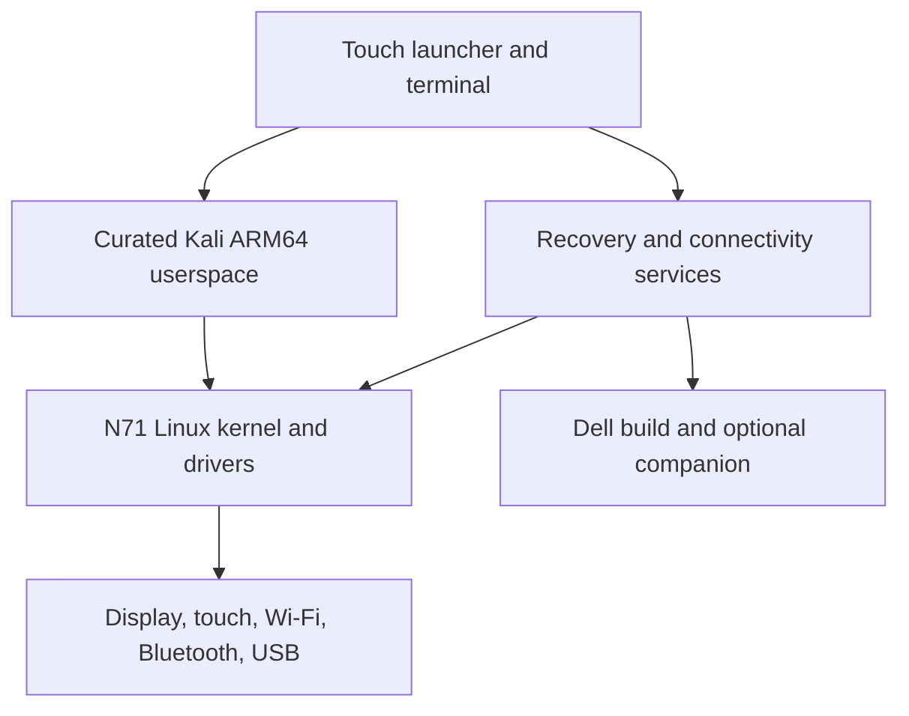

# Cyberdeck product vision and architecture

Reviewed 2026-11-16. This document defines the intended product and separates it from the hardware already demonstrated. It is an engineering plan, not a list of installed applications.

## Purpose

Turn the iPhone 6s N71 into a pocket Linux cyberdeck: a touch-operated local console for system diagnostics, network assessment, Bluetooth work and selected Kali ARM64 security tools. The Dell remains the build/recovery workstation and an optional companion for expensive jobs. Native Wi-Fi should carry ordinary network traffic without relying on USB forwarding.

The initial project also envisaged a fullscreen cyberpunk interface, pinned projects/notes and an optional personal briefing dashboard backed by companion services. These remain part of the wider direction. They do not replace the native Linux console and are not implemented merely because the framebuffer demo displays a cyberdeck screen. Mail/calendar or other private integrations require their own authenticated connectors and acceptance tests; no such account data belongs in the public repository.

## Product layers and implementation status

| Layer | Responsibility | Present state | Acceptance evidence needed |
|---|---|---|---|
| Recovery/build workstation | Pinned sources, cross-build, private asset staging, checksummed RAM payload, recovery | Dell workflow exists | Reproduce the complete integrated candidate and qualify a new boot |
| N71 kernel and device support | Touch/display, USB, native WLAN, Bluetooth transport, battery | Major hardware functions physically demonstrated | Boot recovery, endurance and power-state qualification |
| Minimal recovery userspace | Emergency console and diagnostics, independent of Kali | BusyBox/USB shell works | Authenticated SSH cutover, retained recovery path |
| Connectivity services | Managed brcmfmac, WPA, DHCP/DNS, private BlueZ/D-Bus | Current-session startup/idempotence and four-daemon recovery passed | New integrated RAM boot qualification |
| Kali ARM64 environment | Curated command-line tools and isolated dependency tree | Planned; no on-phone Kali smoke test | Signed package manifest, ARM64 ABI check, measured resources and controlled tool tests |
| Cyberdeck shell/UI | Touch launcher, terminal, keyboard, jobs/status and private results | Native dashboard/ASCII PTY/on-screen keyboard running; native dispatch selftest passed | End-to-end touch-only command execution and result review |
| Optional companion services | Heavy analysis, private project/briefing integrations | Design direction | Explicit service contracts, authentication and offline behavior |

## Runtime topology

Kali shares the custom N71 kernel. A chroot supplies a filesystem and userspace; it neither virtualizes hardware nor makes unavailable kernel capabilities appear. Keep Wi-Fi and BlueZ lifecycle management outside the initial Kali environment so tool-package changes cannot silently replace the validated hardware-control stack.

## Touch-first workflows

A Bluetooth keyboard is useful but must not be required for the first usable handheld release. No keyboard/mouse is currently available; Dell pairing is the controlled Bluetooth acceptance peer.

| Screen/workflow | Required behavior | Current status |
|---|---|---|
| Home/status | Battery percentage, charging state, temperature, USB recovery, WLAN and Bluetooth state | UI requirement; telemetry exists |
| Terminal | Readable local shell, scrollback, copyable private results and an on-screen keyboard | Native PTY/keyboard present; manual touch typing and full terminal features pending |
| Network | Select an owned WLAN, show connection/DHCP state without exposing secrets in public logs | CLI runtime proven; touch workflow not built |
| Bluetooth | Show controller, pair intended peripherals, reconnect and forget selected bonds | Dell CLI test passed; touch workflow not built |
| Tools | Launch a bounded job with an explicit interface/target and a visible stop action | Planned |
| Results | Review logs/PCAP locally; export only selected files with a sanitation step | Planned |
| Recovery | Return to a minimal known-good console when Kali or the launcher fails | USB access works; integrated UI fallback pending |

Do not display implementation details such as DART stream numbers or package hashes in ordinary user workflows. Keep those in diagnostics and build records. An always-on appearance is a design preference; continuous display power and burn-in/thermal behavior are not yet qualified.

## Kali and local/companion responsibilities

Use the [targeted Kali integration plan](KALI_ARM64_INTEGRATION.md) and [package profile manifest](../manifests/kali-tool-profiles.json). Prioritize small CLI tools with clear tests. Large databases, Java desktop applications, long password-recovery workloads and large reverse-engineering sessions should initially run on the Dell, with the phone acting as an authenticated console. This is a resource allocation decision, not a claim those tools can never run on A9.

Native phone networking must remain independently testable. Label every result as local phone execution, Dell-assisted execution, or host-only emulation. A host result must never qualify a phone tool or radio feature.

## Storage and data lifecycle

The current system lives in volatile RAM. Credentials, Bluetooth bonds and installed files can disappear on reboot unless privately included in the next candidate. There is no qualified persistent filesystem and no permission implied to experiment with internal iOS storage.

Initial packaging should preserve a small recovery image, produce an operator-private connectivity candidate, and load a measured Kali subset only when memory permits. A host-served root filesystem or a separately qualified external storage path may be explored later; neither is already operational. Larger images also need independent Pongo transfer-size/time qualification.

Keep private captures, targets, network keys, pairing keys, machine identifiers, firmware and calibration out of Git. Pairing keys and authorized-key provisioning are state, not redistributable examples. Export logs explicitly; do not automatically publish job results.

## Usable cyberdeck release gate

1. An integrated RAM boot restores touch, display, authenticated recovery access, Wi-Fi and Bluetooth automatically.
2. The operator can open a terminal, enter a command and read/stop its output using touch alone.
3. A signed, version-recorded ARM64 tool subset executes on the actual phone within measured RAM and temperature limits.
4. A controlled local TCP assessment and bounded capture of generated lab traffic produce correct, privately retained results.
5. The UI survives a tool failure and returns to recovery without a device reset.
6. Charging and idle operation are observed over an agreed endurance window; the current one-hour lease is not confused with autonomous power management.
7. A fresh boot reproduces the essential workflows; no missing HID peripheral is relabeled as a passed test.

Hardware bring-up is the foundation of this gate. Its completion does not by itself complete the cyberdeck product.

## Deferred features

- Genuine keyboard/mouse HID input until a peripheral is available.
- Bluetooth audio and LE application profiles until individually tested.
- Wi-Fi monitor mode, injection, AP mode, USB host peripherals and USB HID gadget functions until kernel/firmware and physical tests qualify each feature.
- Persistent standalone installation, boot without the present checkm8 workflow, telephony, cameras, GPU acceleration and broad S8003 support.
- Personal dashboard integrations until the local console and security boundary are usable.

See [current hardware](HARDWARE_STATUS.md), [engineering state](PROJECT_STATE_2026_11_16.md), [roadmap](ROADMAP.md) and [issue alignment](ISSUE_STATUS_2026_11_16.md).

## 2026-11-16 implementation follow-up

The native UI and current-session service-recovery layers have advanced beyond the earlier framebuffer proof. [Session evidence](N71_SESSION_FINALIZATION_UI_POWER_2026_11_16.md) distinguishes actual native execution from synthetic keyboard tests and uncompleted manual/boot acceptance. The product gate remains open; Kali packages and a full VT terminal are not present.
